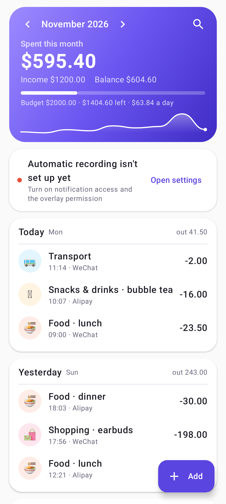
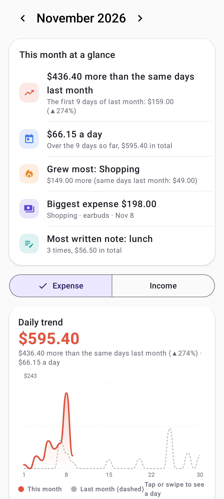
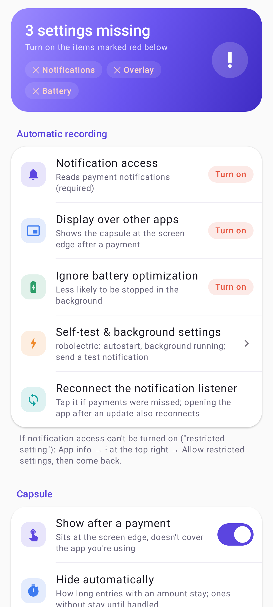

<p align="center"></p>

# Expense Tracking

[简体中文](README.md) | English

An Android expense tracker that records payments from their notifications. After you pay, a small purple
capsule appears at the edge of the screen; tap it to fix the amount, pick a category or add a note.
Your ledger stays on the phone — nothing is uploaded.

UI in English, Simplified Chinese and Traditional Chinese. The currency is a setting
(Settings → Currency: $, €, £, ¥, HK$, NT$ …); it only changes the symbol, there is no conversion.

<p align="center">
  
  
  
</p>

<sub>Screenshots show sample data.</sub>

## What it reads

- **WeChat Pay and Alipay** (China): full support, built from real notifications. Payments are recorded
  directly; notifications without an amount (smartwatch payments, Alipay "someone sent you money") become
  "needs amount" entries and stay in the capsule until you fill them in.
- **Full auto (experimental, optional)**: turn on "Expense Tracking full auto" under the system's
  accessibility settings and the app also reads WeChat / Alipay payment pages and the "WeChat Pay" chat:
  payments made inside those apps without a notification are recorded from the "payment successful" page
  (with the shop name), opening a watch payment's or "sent you money" message fills in its amount, and the
  same payment seen on screen and in a notification is recorded once. Optional "Fetch amounts by itself":
  when the phone is unlocked on the home screen, it opens that message for a few seconds, reads the amount
  and goes back home. Only those two apps are read; nothing leaves the phone.
- **Payment apps in other regions**: the app lists the ones common where you live — Google Wallet,
  Samsung Wallet, PayPal, Wise, Revolut, Monzo, Venmo, Cash App, PayPay, KakaoPay, Toss, Octopus, JKOPAY,
  GCash, Grab, PhonePe, Paytm, Mercado Pago … Turn them on in **Settings → Payment apps**. Their
  notifications are read with a general amount detector, so each entry asks you to confirm it.
  Formats differ by country and bank; if one isn't recognised, see "Help us add formats" below.

## Features

- **Getting started guide**: five pages on first start (what it does, the capsule, the three permissions
  with live status, full auto, tips); open it again under **Settings → General → Getting started**.
- **No duplicates, no merging**: a notification that gets updated is recorded once, but two real payments
  of the same amount right after each other stay two entries.
- **Edge capsule**: no focus stealing, no app switch. Drag it up/down or to the other side, long-press to
  hide; red outline when you're over budget. Entries with an amount: tap a category in the top drawer and
  it's saved. Entries without one: tap one of your usual amounts (editable) in the bottom card.
  Category is optional — saving without one files it under "Other".
- **Categories from notes**: your recent notes are one tap away. A note without a category is filed by
  your rules → the category you picked for that note before → built-in words (coffee, uber, rent, …).
  Add rules in **Settings → Category rules**.
- **Charts**: monthly insights (vs. the same days last month, daily average, fastest-growing category,
  biggest expense, most-used note), daily trend with last month overlaid, spending calendar heatmap,
  category donut and ranking (tap for a per-note breakdown), 6/12-month income/expense trend.
- **Receipts**: attach photos or invoice PDFs (camera / gallery / files) to any entry; stored in the
  app's own folder, never uploaded.
- **Monthly budget**: what's left and how much you can spend per day.
- **Search and filters**: by note, counterpart, category, amount range, channel and date.
- **Bill import** (WeChat .xlsx / Alipay .csv): finds missed payments and fills in amounts for
  "needs amount" entries; the same payment is never imported twice.
- **Home-screen widgets (three)**: 4×2 "This month" (budget ring with the feather, last 7 days, usual amounts you tap to record, pending entries you tap to fill), 2×2 "Today" (the feather, today's spending, your streak) and 4×1 "One-tap entry". They lay themselves out for their real size (two amount buttons when narrow, three when wide) and show a preview in the widget picker. Colours follow the budget (orange when close, red when over, dusk at night).
- **Handy gestures**: swipe an entry left to delete (with undo), right to change its category; long-press for Same again / Category / Change date / Delete; swipe the header to change month; long-press and drag usual amounts and categories into order; a check mark and a light buzz on save, rolling numbers; launcher shortcuts for Add expense / Add income / Search.
- **The feather**: the little purple feather on the home screen changes its face with your budget and the time of day (happy / calm / worried / sad / sleepy). Tap it for a one-line summary.
- **Streak & badges**: opening the app or recording something yourself counts as a check-in; 19 badges (7-day streak, no-spend day, on budget, night owl…) with confetti when you unlock one.
- **Wish jar**: set a goal for something you want, put money in or take it out, and watch the liquid slosh when you tilt the phone; last month's surplus is offered to the jar. It only keeps count; no money moves.
- **Monthly recap**: early each month the home screen offers last month's recap as story cards: total, biggest day, where it went, little habits. Save or share any card as an image.
- **Analysis**: the stats page starts with an overview (spent / income / balance, month-end forecast, budget bar); tap through to four swipeable pages: **Forecast** (where the month is heading, what is left per day, when the budget would run out, next month, how long your wish will take), **Habits** (weekdays, hours, amount sizes, no-spend days), **Categories** (6-month trends, alerts when a category is far above or below usual) and **Year** (a heatmap of every day, month by month, saving rate, and just-for-fun projections like what your bubble tea costs per year).
- **Settings by topic**: automatic recording, capsule, recognition, ledger, fun & motion, general. Under fun & motion you can switch off the feather, the tiles, the recap banner, vibration, animations and the badge pop-up one by one.
- **Blacklist**: apps, and keywords in the payer / merchant / text.
- **Keeping it running**: **Settings → Self-test & background settings** lists the switches to turn on for
  your phone's brand (Xiaomi/Redmi, Huawei, Honor, OPPO/OnePlus/realme, vivo/iQOO, Samsung, Meizu, others)
  with shortcuts to each system page. **Self-test** posts a test notification and checks the app received it.
- Manual entries, CSV export, and a **recognition log** showing every notification and why it was or
  wasn't recorded.
- **Auto-update** from this repository's latest Release, verified by SHA-256.

## Permissions to grant after installing

1. Notification access (required). If Android says "Restricted setting": App info → ⋮ (top right) →
   Allow restricted settings.
2. Display over other apps (for the capsule).
3. Background running: follow **Settings → Self-test & background settings** for your brand, then run the self-test.
4. Optional: "Expense Tracking full auto" under accessibility (see Full auto above). It may also say
   "Restricted setting"; handle it as in step 1.

## Help us add formats

Open **Settings → Self-test & background settings → Export diagnostics**. The report contains your phone
model, Android version, permission state and the last 80 recognition-log lines — no ledger amounts or
notes. Notification texts are hidden unless you choose to include them. Remove anything personal and
open an Issue with it.

## Build

Needs JDK 17+ and the Android SDK (compileSdk 37, build-tools 36.1.0).

```bash
./gradlew :app:testDebugUnitTest   # unit tests: notification parsing, bill import, auto-categories
./gradlew :app:assembleRelease
# UI screenshots on the PC (Robolectric; tests need JDK 17/21):
./gradlew :app:testDebugUnitTest -Pscreenshots=true -PtestJavaHome=/path/to/jdk17 --tests "*ScreenshotTest*"
```

Dependencies are fetched from Aliyun Maven mirrors first (see `settings.gradle.kts`). Release signing
reads `../keys/keystore.properties` outside the repository; without it, release builds use the debug key.

Translations: `res/values/` is English (default), `res/values-zh/` Simplified Chinese.
Traditional Chinese (`res/values-b+zh+Hant/`) is generated from Simplified by
`python tools/make-zh-hant.py` (OpenCC, Taiwan wording) — rerun it after editing the Simplified strings.

## Releases

Each Release carries three files with fixed names, read by the in-app updater:

| File | Contents |
|---|---|
| `version.json` | `{"version","versionCode","apk","sha256","notes"}` |
| `ExpenseTracking-<version>.apk` | the app |
| `SHA256SUMS.txt` | checksums |

Tag as `v<version>`, e.g. `v0.2.0`.

## License

[MIT](LICENSE)
