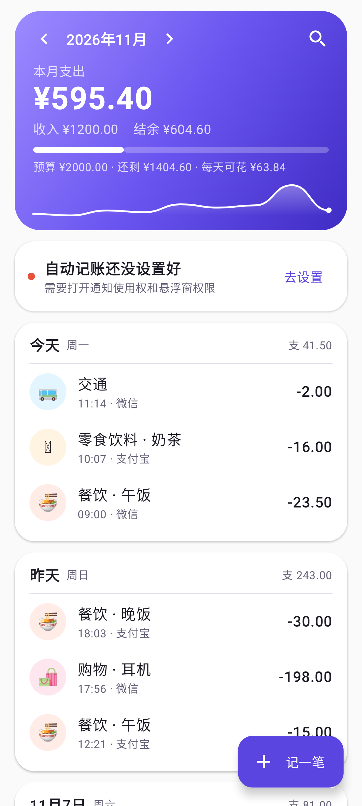
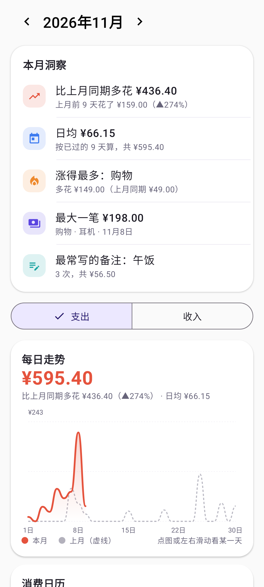
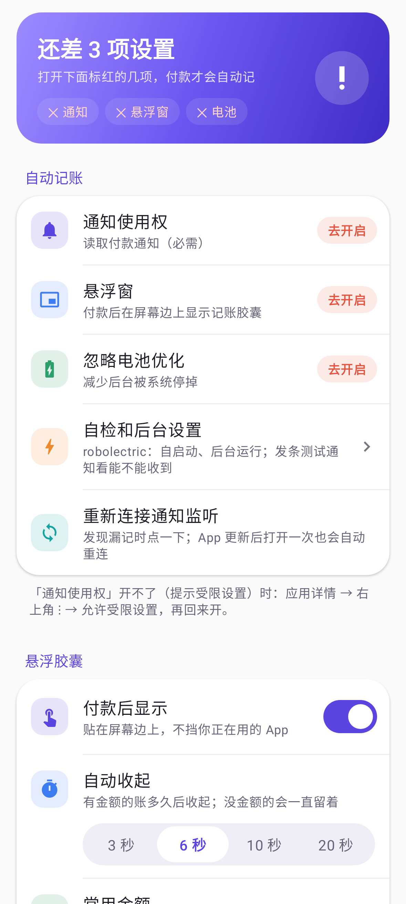

<p align="center"></p>

# Expense Tracking

简体中文 | [English](README.en.md)

一个读付款通知自动记账的 Android App：微信、支付宝付款后自动入账，屏幕边上弹出一个紫色小胶囊，
点开就能补金额、选分类、写备注。账单只存在手机里，不联网上传。

界面有简体中文、繁體中文、English 三种语言；货币可以在「设置 → 货币」里改（¥、$、€、HK$、NT$……，只改显示的符号，不换算汇率）。

<p align="center">
  
  
  
</p>

<sub>截图里是示例数据。</sub>

## 功能

- **自动记账**：微信「已支付¥30.00」、支付宝「你有一笔10.00元的支出」等直接入账；
  同一条通知被刷新不会重复记，金额相同的两笔连续消费也不会被并成一笔。
- **没有金额的通知不丢**：手表付款（微信只显示「微信支付凭证」）、支付宝「某某给你转了1笔钱」
  会记成「待补金额」，胶囊一直留着，填了金额才算进统计。
- **其他地区的支付 App**：按手机的语言和地区列出常用的支付 App（Google Wallet、Samsung Wallet、PayPal、
  PayPay、八達通、街口支付等），打开后用通用规则识别通知里的金额，识别到的账要你确认一下才记。
  在「设置 → 支付 App」里选。
- **贴边胶囊**：付款后屏幕边上出现紫色胶囊（待补金额时是浅紫色），不抢焦点、不跳转；可以上下拖、拖到另一边，长按收起；超预算时描红边。点开后，有金额的账在顶部抽屉里点分类就记好；没写金额的账在底部卡片里点常用金额（可自定义）。分类可不选，直接保存记到「其他」。
- **按备注分类**：卡片里列出常写的备注，点一下就填好；写了备注没选分类，按你的规则 → 你以前给这个备注选的分类 → 内置常用词（奶茶、打车、话费、coffee、uber……）自动归类，都对不上才记到「其他」。规则在「设置 → 分类规则」里加。
- **复盘图表**：本月洞察（比上月同期、日均、涨得最多的分类、最大一笔、最常写的备注）、本月每日走势（叠上月对比）、消费日历热力图、分类环形图和排行（点开看按备注的明细）、近 6/12 个月收支趋势。
- **凭证**：每笔账可以加收据照片、发票 PDF（拍照 / 相册 / 文件），存在 App 自己的目录里，不上传；照片会转正并压缩。
- **月度预算**：首页显示还剩多少、每天还能花多少。
- **搜索和筛选**：按备注、对方、分类、金额区间、渠道、时间找账。
- **导入账单对账**：导入微信（.xlsx）/ 支付宝（.csv）官方导出的账单，找出漏记的一键补上，
  还能给手表付款这类“待补金额”的账自动补上金额；同一笔不会导入两次。
- **桌面小组件（三种）**：4×2「本月」（预算环 + 小羽毛、近 7 天柱状、常用金额一点就记、待补金额一点就补）、2×2「今日」（小羽毛 + 今天花了多少 + 打卡天数）、4×1「一键记账」；颜色跟着预算变化（快超是橙、超了是红、深夜是夜色）。
- **顺手的操作**：账单左滑删除（可撤销）、右滑改分类、长按出菜单（再记一笔一样的 / 改分类 / 改日期 / 删除）；首页头部左右滑切换月份；常用金额和分类长按拖动排序；保存时有对勾动画和震动，金额数字会滚动；长按桌面图标有「记一笔支出 / 收入 / 搜索」。
- **小羽毛**：首页的紫色小羽毛会随预算和时间换表情（开心 / 平静 / 紧张 / 难过 / 深夜犯困），点它会说一句今天的小结。
- **打卡和徽章**：每天打开看一眼或亲手记一笔就算打卡；19 枚徽章（连续 7 天、无消费日、守住预算、夜猫子……），解锁时撒花。
- **心愿罐**：给想买的东西设个目标，存入 / 取出，罐子里的液体会跟着手机倾斜晃动；上个月有结余会提醒存进去。只是记个数，不动真钱。
- **月度回顾**：每月初首页出现上个月的回顾，像故事一样一页页点：花了多少、哪天最能花、钱去哪了、小习惯；每页可保存图片或分享。
- **黑名单**：拉黑的 App 不记；付款方/商户/内容含黑名单关键词的不记。
- **后台保活向导**：「设置 → 自检和后台设置」按手机品牌（小米/红米、华为、荣耀、OPPO/一加/realme、vivo/iQOO、三星、魅族等）
  列出要打开的开关，能直接跳到对应的系统页面；「自检」会发一条测试通知，看 App 是否真的收到。
  遇到问题可以导出诊断信息（不含账单金额和备注，通知原文默认隐藏）。
- 0 元免密/自动扣款提示、聊天消息、其他 App 的「收益已入账」等不记（其他 App 可在设置里打开识别，需确认才记）。
- 手动记账、导出 CSV、识别记录（看每条通知记了没有、为什么）。
- **自动更新**：从本仓库最新 Release 下载，校验 SHA-256 后安装；可以填下载加速前缀。

## 安装后要打开的权限

1. 通知使用权（必需）。如果提示「受限设置」：应用详情 → 右上角 ⋮ → 允许受限设置。
2. 悬浮窗。
3. 后台运行：按「设置 → 自检和后台设置」里的步骤做（忽略电池优化、自启动等，不同品牌不一样），做完点「自检」。

## 导出账单（用于对账）

- 微信：我 → 服务 → 钱包 → 账单 → 右上角 ⋯ → 下载账单 → 用于个人对账。
- 支付宝：我的 → 账单 → 右上角 ⋯ → 开具交易流水证明 → 用于个人对账。

文件会发到邮箱，是加密压缩包（密码在微信/支付宝的消息里）。解压后在「设置 → 导入账单对账」里选 .xlsx / .csv。

## 编译

需要 JDK 17+、Android SDK（compileSdk 37、build-tools 36.1.0）。

```bash
./gradlew :app:testDebugUnitTest   # 通知解析、账单导入、自动分类的单元测试
./gradlew :app:assembleRelease
# 界面截图（Robolectric，需要 JDK 17/21 跑测试）：
./gradlew :app:testDebugUnitTest -Pscreenshots=true -PtestJavaHome=/path/to/jdk17 --tests "*ScreenshotTest*"
```

依赖优先走阿里云 Maven 镜像（见 `settings.gradle.kts`）。正式签名读取仓库外的
`../keys/keystore.properties`；没有这个文件时 release 用 debug 密钥签名。

翻译：`res/values/` 是英文（默认），`res/values-zh/` 是简体中文；繁體中文 `res/values-b+zh+Hant/`
由 `python tools/make-zh-hant.py` 从简体生成（OpenCC，台湾用词），改了简体后重新跑一次。

## 发版

Release 需要三个固定名字的文件，App 的自动更新会读它们：

| 文件 | 内容 |
|---|---|
| `version.json` | `{"version","versionCode","apk","sha256","notes"}` |
| `ExpenseTracking-<版本>.apk` | 安装包 |
| `SHA256SUMS.txt` | 校验值 |

Tag 写成 `v<版本>`，例如 `v0.2.0`。

## 识别规则从哪来

微信、支付宝的规则来自作者手机（vivo，Android 16，微信 8.0.76，支付宝 12.12.6）上真实收到的通知，
测试样例在 `app/src/test/.../ParserTest.kt`。其他支付 App 用通用规则，格式各地不同，可能认不全。
遇到没认出的格式，在「设置 → 识别记录」里能看到原文，欢迎提 Issue（请先去掉个人信息）。

## 许可证

[MIT](LICENSE)
